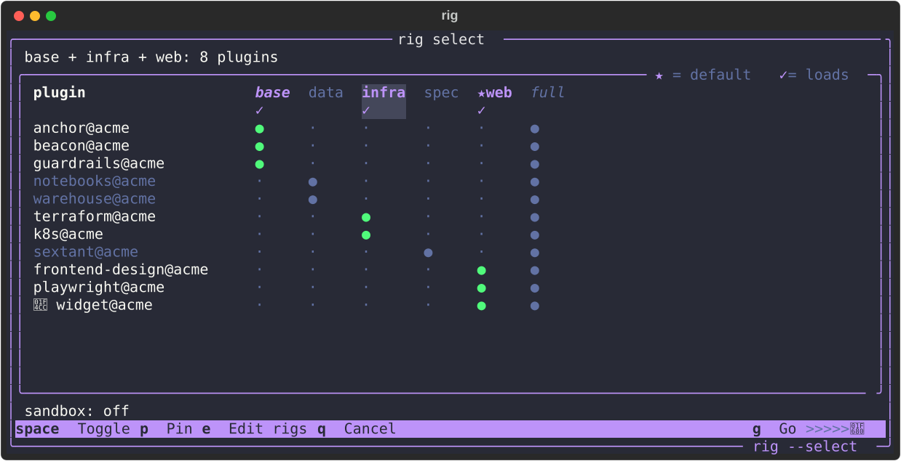

# rig

**Switch Claude Code between groups of plugins.**

Claude Code loads every plugin you've enabled into every session. rig lets you
name a group of plugins once, as a **rig**, and launch with the rigs the work
calls for: `infra` for the Terraform repo, `web` for the frontend, both for a
change that spans them. A `claude` launched in a folder picks up the rigs that
fit that folder on its own.



## Why you'd want it

**Every plugin costs every session something.** Before you type anything, a
session has loaded each enabled plugin's skill descriptions, its commands and
agents, its MCP servers' tools, and whatever its hooks inject at startup. That
is context the model reads and you pay for on every turn, whether or not the
work needs that plugin. Run `/context` in a session to see what yours cost. The
more plugins you collect, the more of every session goes to the ones it isn't
using.

**Plugins for one job get in the way of another.** A skill meant for
infrastructure work triggers in a frontend session. A hook written for one
repo's workflow fires in every repo. With fewer plugins loaded, the ones that
are loaded are the ones you meant.

**Claude Code's own switch is a setting, not a launch.** `/plugin enable` and
`/plugin disable` change `~/.claude/settings.json` for every session after
this one. Trying a different set for an afternoon means remembering to undo
it, and two terminals can't run different sets at once. With rig, the set of
plugins belongs to the launch: each session gets its own, and none of them
changes what the next one loads.

## How it works

```bash
claude                  # the base rig, plus the rigs that fit this folder
rig use infra           # base + infra
rig use web infra       # base + web + infra
rig                     # pick the rigs on the graph above, then launch
```

- The **base** rig holds the plugins you want in every session. Every launch
  loads it.
- **Other rigs** are small groups of plugins for a kind of work. A launch adds
  any number of them on top of base.
- **Folder rules** make a rig load wherever it fits, by folder path or by what
  the repo holds, so `rig use` is for the exceptions. A rig for Terraform can
  load in any repo with a `.tf` file in it.
- `rig setup` is a full-screen editor for your rigs, and first-run setup builds
  your base rig from the plugins your settings enable today.
- `/rig` switches a running session to other rigs and keeps the conversation.

[Getting started](/getting-started) installs rig and walks through the first
launch. [Rigs](/rigs) covers rigs, folder rules, and switching in depth.

## For plugin authors: pins

If you write plugins, rig also closes the gap between editing a plugin and
using it. **Pin** your local checkout of a plugin and it stands in for the
installed copy in every rig that includes the plugin, so your edits take effect
in real sessions without a marketplace release:

```bash
rig pin ~/src/acme/widget     # or `rig pin widget`, or `rig pin` from inside it
rig unpin widget              # back to the installed copy
```

[Pins](/pins) covers how they load and how rig finds your checkouts.

## Reference

[Reference](/reference) lists the commands, the keys in each full-screen view,
and the `~/.rig/rigs.yml` format. The [spec](/spec) states what rig does,
requirement by requirement.
