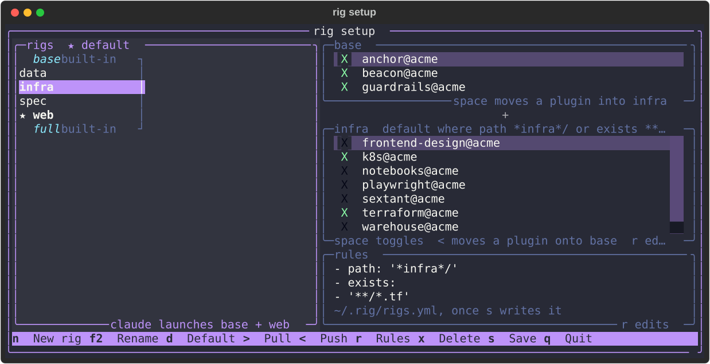

# Getting started

## Install

rig is a Claude Code plugin with a command-line tool inside it. It runs
through [uv](https://docs.astral.sh/uv/), so uv must be on your PATH.

Install the plugin:

```bash
claude plugin marketplace add chris-peterson/claude-marketplace
claude plugin install rig@chris-peterson
```

Then run its bootstrap from a Claude Code prompt:

```text
/rig:install-rig
```

That puts `rig` on your PATH at `~/.local/bin/rig`, with zsh tab completion,
and makes `claude` run rig in new shells, so the command you already type picks
up your rigs. When a plugin update leaves the `rig` on your PATH behind, a
session start tells you to run `/rig:install-rig` again.

If another shell function already defines `claude` (a wrapper of your own),
rig leaves it alone. Have that wrapper call `rig claude "$@"` where it called
`claude`.

When [Grok Build](/tools) is on your PATH, the install makes `grok` run
`rig grok` the same way.

To check the setup, open a new shell and run:

```bash
rig doctor
```

It checks what a new zsh sees: that `rig` on your PATH runs the installed
plugin, that `claude` runs rig, and that zsh completes both. A failed check
prints the command that fixes it. Claude Code's own doctor runs after rig's
checks, so `claude doctor` reports both.

## Before you adopt it

!> **rig turns off the plugins your Claude Code settings enable.** Every
Claude Code launch through rig sets each plugin `~/.claude/settings.json` enables to off,
so a session starts with exactly the rigs you chose. Claude Code started some
other way (an IDE extension, the desktop app) reads the same settings file, so
it starts without those plugins.

Put everything you want in every session in the base rig, as few or as many
plugins as you like. First-run setup starts it from the plugins your settings
enable today, so nothing goes missing on the first launch.

## The first launch

Run `claude` or `rig` at a terminal. With no rigs yet, rig opens the rig editor
before starting Claude Code:



The **base** rig starts with the plugins your settings enable. Turn off the
ones not every session needs; they're what your other rigs are for.

Each group of installed plugins that no rig names shows under *suggestions* as
a draft. Press `s` on a draft to name it and save it as a rig. If your settings
file separates its `enabledPlugins` entries with blank lines, each group
becomes a draft; otherwise each marketplace does.

Press `d` on a rig to make it a default, one a plain `claude` adds on top of
base (★ marks them). Press `s` to save to `~/.rig/rigs.yml`, then `q` to go on
to the launch. Quitting without saving stops the launch, and the next one opens
setup again.

Before Claude Code starts, rig prints what the session loads:

```text
rig: base + web, 9 plugins
📌 widget  ~/src/acme/widget  (3 days ago)
```

## Every launch after

```bash
claude                      # base plus your default rigs
claude "fix the bug"        # a prompt, with the default rigs
rig use infra               # base plus infra, instead of the defaults
rig                         # open the picker first
rig setup                   # change your rigs
```

Anything rig doesn't recognize goes to Claude Code unchanged, and Claude Code's
own subcommands (`claude plugin list`, `claude mcp`) run without a rig.

Next: [Rigs](/rigs) to shape your rigs and have them load by folder, or
[Pins](/pins) if you develop plugins.
