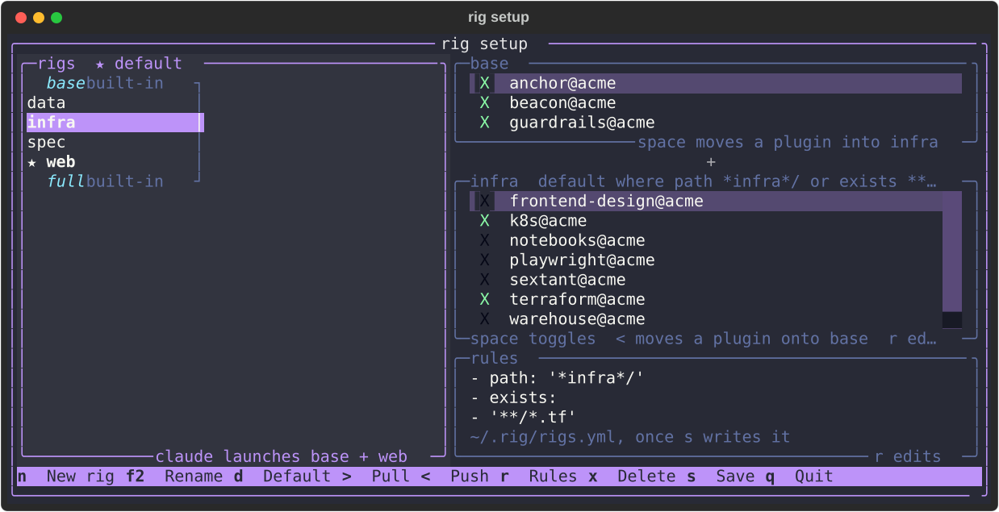
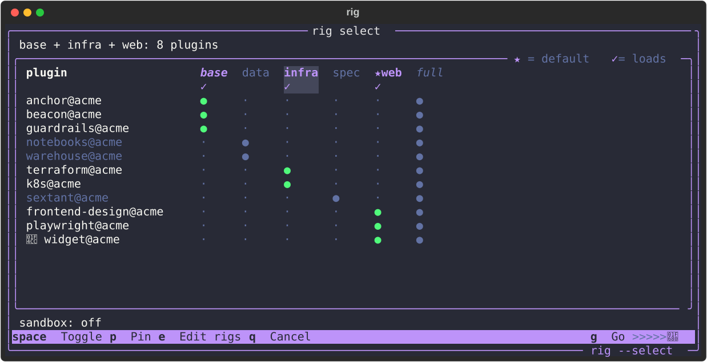

# Rigs

A rig is a named list of plugins. Every launch loads the **base** rig, and you
add other rigs on top of it for the work at hand: small sets like `infra` or
`web` that you combine as you need them.

```bash
claude                      # base plus your default rigs
rig use infra               # base plus infra
rig use web infra           # base plus both; `web,infra` and "web infra" work too
rig use full                # every installed plugin
rig use none                # stock Claude Code, no plugins at all; asks first
rig list                    # every rig and its plugins
rig list --graph            # a table of plugins against rigs
```

Tab completion offers the rigs after `rig use`, and again after each space or
comma, leaving out the ones already named.

Two rigs are built in:

- **`full`** is every plugin you have installed, for the session where you
  don't want to think about it.
- **`none`** is Claude Code as it ships: every plugin is off for that session,
  the base rig's and your pins included. Since that also drops the hooks and
  guardrails you're used to, rig says so and asks before it launches.

## Shaping your rigs

Keep base small: the plugins you'd want even in a session you haven't planned.
Then group the rest by the kind of work that needs them. A rig of two or three
plugins is normal; you combine them at launch rather than building one rig per
combination.

`rig setup` opens the rig editor: your rigs on the left, from `base` at the top
to `full` at the bottom, and the selected rig's plugins on the right.



Every rig other than `base` and `full` shows as two boxes, `base` + the rig.
Toggle a plugin in the `base` box and it moves down into the rig; `>` does the
same for any plugin, and `<` moves the highlighted plugin onto `base`. A ★
marks the default rigs, the ones a launch adds when it names none (`d` toggles
it), and the bottom of the rigs pane shows what a plain `claude` launches. The
[reference](/reference#rig-setup) lists every key.

A rig names plugins as `<plugin>@<marketplace>`. When a rig names one that
isn't installed, launching at a terminal installs it first.

## Rigs that pick themselves: folder rules

Most of the time you shouldn't have to name a rig. A rig can carry rules that
make it a default wherever they match, so a plain `claude` picks up what the
folder needs:

```yaml
default: []                       # defaults everywhere; rules add to these
rigs:
  work:
    plugins: [...]
    rules:
      - path: ~/src/acme/         # this folder and everything under it
  infra:
    plugins: [...]
    rules:
      - path: "*infra*/"          # any folder with infra in its name, at any depth
      - exists: ["**/*.tf"]       # or a repo holding Terraform
  spec:
    plugins: [...]
    rules:
      - exists: SPEC.md           # at the repo root
  release:
    plugins: [...]
    rules:
      - path: ~/src/acme/         # both conditions have to match
        exists: [.gitlab-ci.yml]
```

A rig loads when any of its rules matches, and a rule matches when each
condition it gives does:

- **`path`** matches the folder you launch in the way git's
  `includeIf "gitdir/i:"` does. Case doesn't matter, and `~/` is your home
  folder. A pattern that doesn't start with `/` or `~/` matches at any depth,
  `*` stays within one folder name, and `**` spans folders. A trailing `/`
  matches that folder and everything under it.
- **`exists`** takes one glob or a list of them, matched from the root of the
  repo you launch in, the way GitLab CI's `rules:exists` matches. It counts
  tracked files and untracked ones git doesn't ignore. Outside a repo, it
  looks at the first 10,000 files under the folder.

The launch says which rule added each rig:

```text
rig: base + work + infra, 21 plugins
by rule: work (path ~/src/acme/), infra (exists **/*.tf)
```

Naming rigs (`rig use web`) skips the rules. `rig list` shows which rigs are
defaults in the current folder and why; `rig list --graph` and the picker star
them.

To edit a rig's rules, select it in `rig setup` and press `r`. Its rules open
as YAML in git's editor (`git var GIT_EDITOR`), or, without git, in `$VISUAL`,
`$EDITOR`, or `vi`. When you save and close, they become unsaved changes, and
`s` writes them to `~/.rig/rigs.yml`. If what you wrote isn't valid, the editor
says why and keeps the old rules, and the next `r` opens what you wrote so you
can fix it. The box under the rig's plugins shows its rules as `rigs.yml` holds
them, and the path under them links to the file: cmd+click it (or your
terminal's equivalent) to edit `rigs.yml` directly.

## Picking at launch

`rig` alone, or `--select` with any launch, opens a picker before Claude Code
starts:



The rigs run across the top and their plugins down the side, with a 📌 in front
of each pinned plugin. A ✓ under a rig's name means the launch loads it, and
the plugins it loads stay bright while the rest dim. Move with the arrow keys
or `h` `j` `k` `l`, toggle with space or a click, and press `g` to launch.
`rig use web --select` starts the picker with `web` chosen.

Toggling a plugin's row launches with one plugin more or less: it comes out of
the launch even when a rig holds it, or goes in when none does. A rig the
launch then loads only part of shows a yellow ◐. The launch summary names
those plugins after the rigs: `rig: base + web + playwright@acme - sonar@acme`.

`e` opens the rig editor and brings you back to the picker when you quit it.
`p` pins the plugin on the cursor's row (see [Pins](/pins)). The
[reference](/reference#the-picker) lists every key.

A launch with arguments, plain `claude` included, never opens the picker on its
own: it installs the plugins the rigs need and loads your pins as the picker
would have offered them.

## Switching mid-session

```text
/rig
```

`/rig` opens the same picker inside a running session, set to what the session
loads now. Pick other rigs, press `g`, and the session moves to them with its
conversation intact. `/rig web infra` skips the picker and switches straight to
the rigs you name.

A session can't change its plugins while it runs, so the switch happens across
a restart: rig records the switch, Claude Code exits on its own, and rig
relaunches the same conversation with what you chose. Nothing is added to the
conversation; a toast names the rigs it switched to, and the session waits for
your next prompt. The options you passed to Claude Code, such as `--model` or
`--plugin-dir`, carry over. The prompt doesn't, and neither do options that
pick or start a conversation (`--continue`, `--resume`, `--worktree`, and the
like), since the switch resumes the conversation itself.

rig stays running while Claude Code does, which is how it sees the exit. A
session started without rig, or with nobody at a terminal, can't be relaunched
this way; the switch prints the `rig use <rig>... --resume <id>` command to run
after you exit.

## How rigs meet your settings

Every launch through rig sets each plugin `~/.claude/settings.json` enables to
off, then starts Claude Code with the rigs' plugins turned on for that session
alone. That is what lets two terminals run different rigs at once, and why
Claude Code started another way (an IDE, the desktop app) starts without them.

- A plugin you enable during a session with `/plugin enable` loads in that
  session. The next launch turns it off again in `~/.claude/settings.json` and
  names it; add it to a rig to keep it.
- Plugins a repo's own `.claude/settings.json` enables load alongside your
  rigs. A rig plugin the repo's settings turn off stays off, and the launch
  summary names it.
- Claude Code's own subcommands (`claude plugin list`, `claude mcp`) run
  without a rig.
